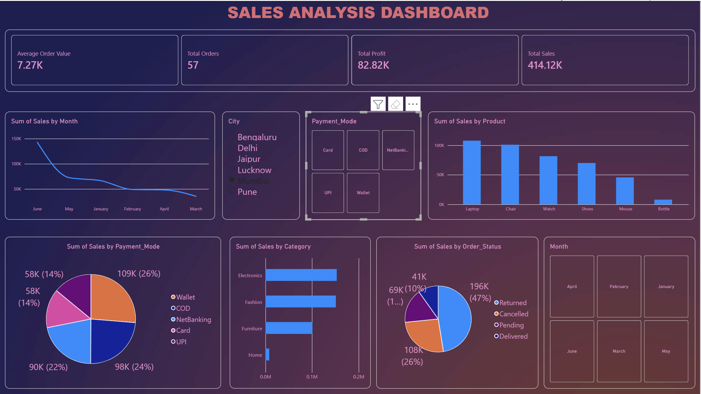

# Ecommerce-Sales-Analysis-SQL-Excel-PowerBI

## 📌 Project Overview
An end-to-end data analytics project evaluating e-commerce sales performance, order volume, profitability, and regional trends. The goal of this project was to clean raw transaction records, uncover key revenue drivers, and build an interactive executive dashboard for data-driven decision-making.

---

## 📊 Dashboard Preview

---

## 🛠️ Tech Stack & Workflow
1. **Excel (`ecommerce_clean_ecommerce.xlsx`):** Performed initial data profiling, checked formatting consistency, and validated raw columns.
2. **Python / Jupyter Notebook (`ecommerce_eda_analysis.ipynb`):** Handled missing values, removed duplicates, standardized data types, and ran exploratory data analysis (EDA) using Pandas.
3. **SQL (`ecommerce_queries.sql`):** Wrote aggregation queries to cross-verify KPI totals, regional sales breakdowns, and category profitability.
4. **Power BI (`Ecommerce_Dashboard.pbix` & `DAX_Measures.tmdl`):** Built the data model, scripted custom KPI measures in TMDL view, and designed interactive visuals including geospatial maps and dynamic slicers.

---

## 📐 Key DAX Measures
All core KPIs were organized inside a dedicated `DAX_MEASURE` table using TMDL:
* **Total Sales:** `SUM('ecommerce clean_ecommerce'[Net_Amount])`
* **Total Profit:** `SUM('ecommerce clean_ecommerce'[Profit])`
* **Total Orders:** `COUNT('ecommerce clean_ecommerce'[Order_ID])`
* **Average Order Value (AOV):** `DIVIDE([Total Sales], [Total Orders])`

---

## 💡 Key Business Insights
* **Top Performing Category:** [e.g., Electronics generated the highest revenue, accounting for XX% of Total Sales.]
* **Regional Trends:** [e.g., Maharashtra and Karnataka led in total order volume and net profit on the geospatial map.]
* **Profitability vs. Sales:** [e.g., While Category X had high order volume, Category Y delivered a higher Average Order Value and profit margin.]

---

## 📂 Repository Structure
* `images/` — High-resolution screenshots of the Power BI dashboard.
* `ecommerce_eda_analysis.ipynb` — Jupyter Notebook containing Python data cleaning and EDA.
* `ecommerce_queries.sql` — SQL scripts used for querying and KPI validation.
* `ecommerce_clean_ecommerce.xlsx` — Cleaned e-commerce dataset.
* `DAX_Measures.tmdl` — Tabular Model Definition Language script for custom Power BI measures.
* `Ecommerce_Dashboard.pbix` — Interactive Power BI Desktop report file.
